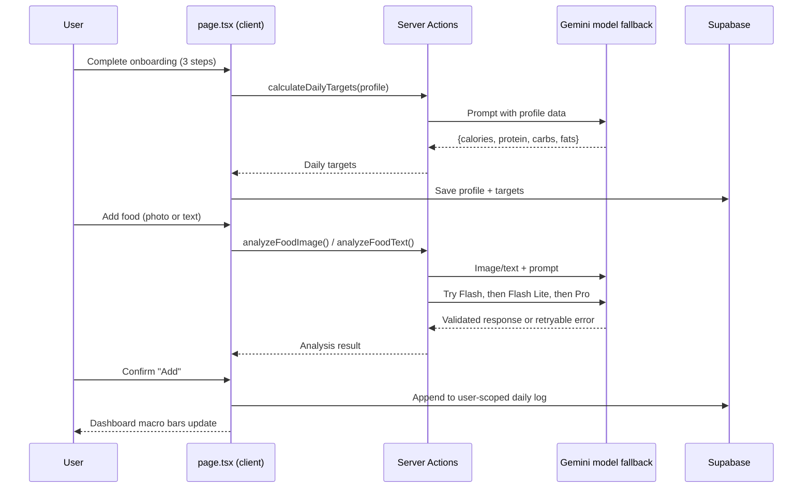
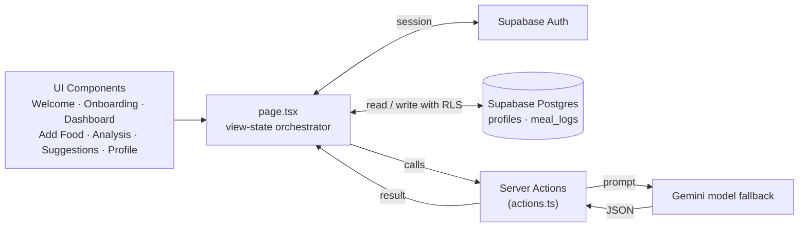

# Nutrino — AI Food & Nutrition Tracker

Nutrino turns a photo or a text description of a meal into full nutritional breakdown — no manual macro lookup, no barcode scanning. Point your camera at your food, or type what you ate, and Gemini identifies it and returns calories, protein, carbs, and fats in seconds. Onboarding also uses AI to calculate personalized daily targets (BMR/TDEE) from your profile, so the whole app adapts to you from the first screen.

**Stack:** Next.js · TypeScript · Tailwind CSS · Google Gemini 2.5 Flash

---

## Why This Project

Most nutrition trackers rely on massive manual food databases that are tedious to search and often out of date. Nutrino skips the database entirely — Gemini *is* the food database. Snap a photo, get macros. This also made it possible to build and ship a fully working product as a solo side project, with zero backend infrastructure to stand up or maintain.

---

## How It Works

1. **Onboarding** — user answers a 3-step flow (basics, goals, environment); the collected profile is sent to Gemini, which calculates BMR/TDEE and returns personalized daily calorie/macro targets
2. **Log a meal** — user either takes/uploads a photo or types a text description
3. **Analyze** — the image or text is sent to a server action, which prompts Gemini to identify the food and return `{food_name, calories, protein, carbs, fats}`
4. **Review & save** — the result is shown for confirmation, then saved into that day's log
5. **Suggestions** — on request, Gemini generates meal suggestions filtered by preference (e.g. "High Protein"), and can expand any suggestion into a full recipe with ingredients and steps
6. **Dashboard** — daily macro bars update live against the personalized targets from onboarding

AI calls try Gemini 2.5 Flash, then Flash Lite, then Pro. Each response is parsed and checked against the expected data shape before it is accepted. If every model fails, the UI shows an error and lets the user retry; the app does not silently substitute mock nutrition data.



---

## Architecture

Supabase Auth manages email/password accounts, and Supabase Postgres stores profiles and date-keyed meal logs. Next.js Server Actions handle authenticated Gemini requests. Row-level security policies restrict profile and meal-log access to the owning user.



**"Routing" without routes:** the app is a single page (`app/page.tsx`) with no file-based Next.js routing. A `view` state variable (`welcome`, `onboarding`, `dashboard`, `add_food`, `analysis_page`, `suggestions`, `meal_details`, `notifications`, `profile`, `manual_entry`) decides what renders, and every component is "dumb" — it takes props and fires callbacks, with all state and logic centralized in `page.tsx`.

---

## Key Engineering Decisions

| Decision | Why |
|---|---|
| **Server Actions instead of a REST API** | `'use server'` functions in `actions.ts` run only on the server — the `GEMINI_API_KEY` never reaches the browser, with none of the boilerplate of standing up `/api` routes |
| **Gemini as the only external dependency** | Every "smart" feature — food analysis, meal suggestions, recipe details, BMR/TDEE calculation — is a single Gemini prompt, instead of maintaining a nutrition database |
| **Gemini model fallback** | AI actions try Flash, Flash Lite, and Pro in sequence, validate the response shape, and offer a user-triggered retry if all models fail |
| **`view`-state routing instead of file-based routes** | The whole app is one client component; simpler state management for a fast-moving solo project, at the cost of no deep-linkable URLs |
| **Supabase Auth + Postgres** | Users create accounts before onboarding; profiles and meals persist across sessions and are protected by row-level security |
| **Client-side image resize before upload** | `imageUtils.ts` downscales photos to 1024px / JPEG quality 0.8 via canvas before they're sent to the server action, cutting upload size and Gemini image-token cost |

---

## Server Actions

| Function | Called From | What It Does |
|---|---|---|
| `analyzeFoodImage()` | `AddFoodChoice` | Sends a resized photo to Gemini → returns food name + macros |
| `analyzeFoodText()` | `AddFoodChoice` | Sends a text description to Gemini → returns food name + macros |
| `generateMealSuggestions()` | `page.tsx` → `MealSuggestions` | Returns 2 AI meal suggestions filtered by preference (e.g. Balanced, High Protein) |
| `generateMealDetails()` | `MealDetails` | Returns full recipe (ingredients + steps) for a chosen meal |
| `calculateDailyTargets()` | `page.tsx`, on onboarding completion | Calculates BMR/TDEE and daily calorie/macro targets from the user's profile |

---

## Project Structure

```
nutrino/
├── app/
│   ├── layout.tsx        # Root shell 
│   ├── page.tsx           # Central orchestrator 
│   ├── actions.ts          # Server Actions 
│   ├── auth/callback/     # Email confirmation callback
│   └── globals.css
├── lib/
│   ├── gemini.ts           # Model fallback and response validation
│   ├── database.types.ts   # App data model
│   ├── imageUtils.ts
│   └── supabase/           # Browser and server clients
├── proxy.ts                # Refresh Supabase auth cookies
└── supabase/
    └── migrations/         # Profiles, meal logs, and RLS policies
└── components/
    ├── WelcomeScreen.tsx
    ├── onboarding/
    │   ├── OnboardingFlow.tsx
    │   ├── Step1Basics.tsx
    │   ├── Step2Goals.tsx
    │   └── Step3Environment.tsx
    ├── Dashboard.tsx
    ├── AddFoodChoice.tsx
    ├── AnalysisPage.tsx
    ├── AnalysisResultModal.tsx
    ├── ManualEntry.tsx
    ├── MealSuggestions.tsx
    ├── MealDetails.tsx
    ├── Notifications.tsx
    ├── Profile.tsx
    └── SideMenu.tsx
```

---

## State & Persistence

UI state lives in `page.tsx`; durable account data is stored in Supabase:

| Table | Holds |
|---|---|
| `profiles` | Onboarding answers, activity level, recommended/editable daily targets |
| `meal_logs` | User-owned meals, portion, macros, and browser-local calendar date |

---

## Getting Started

```bash
git clone https://github.com/Saad-V/nutrino.git
cd nutrino
npm install

# configure environment
cp .env.example .env
# set GEMINI_API_KEY, NEXT_PUBLIC_SUPABASE_URL, NEXT_PUBLIC_SUPABASE_PUBLISHABLE_KEY

# In Supabase SQL Editor, run:
# supabase/migrations/202610310001_initial_schema.sql

# In Supabase Auth settings, enable email/password and allow:
# http://localhost:3000/auth/callback

npm run dev
```

Accounts are required before onboarding. If Supabase email confirmation is enabled, users must confirm their email and then sign in. Set the Supabase Site URL and allowed redirect URLs for both local development and the deployed app.

---

## Tech Stack

- **Framework:** Next.js 16 (App Router), TypeScript
- **Styling:** Tailwind CSS v4, Poppins/Lato/Manrope (Google Fonts), Material Symbols Outlined
- **AI:** Google Gemini 2.5 Flash (REST API, via Server Actions)
---

Author
V Muhammed Saad Sabeel